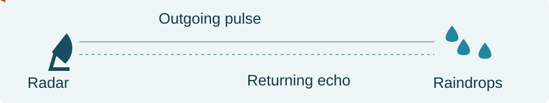
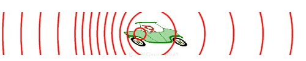
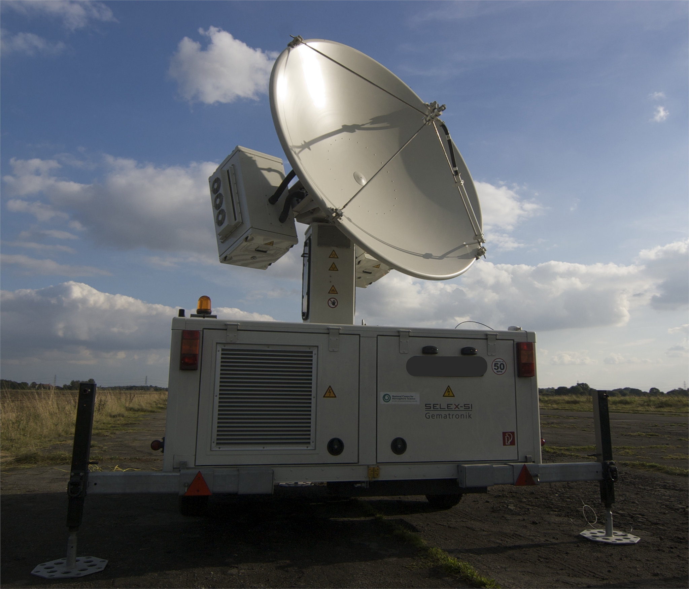
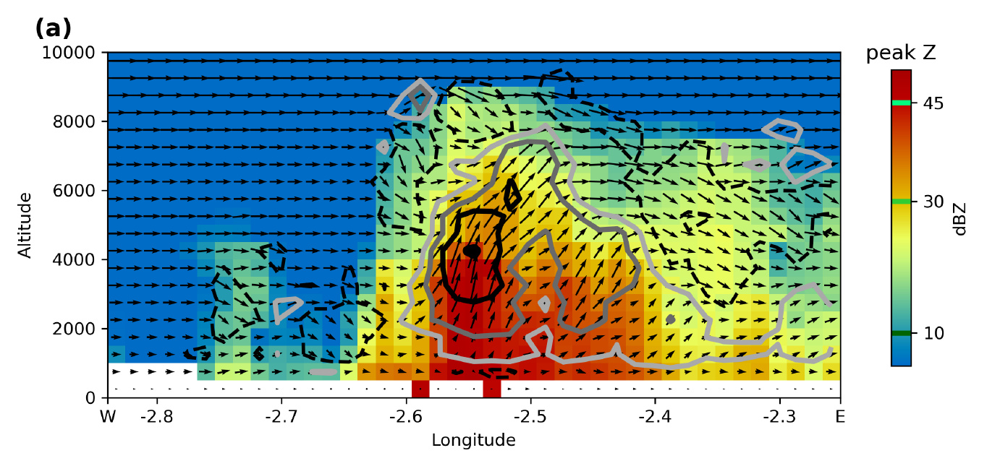
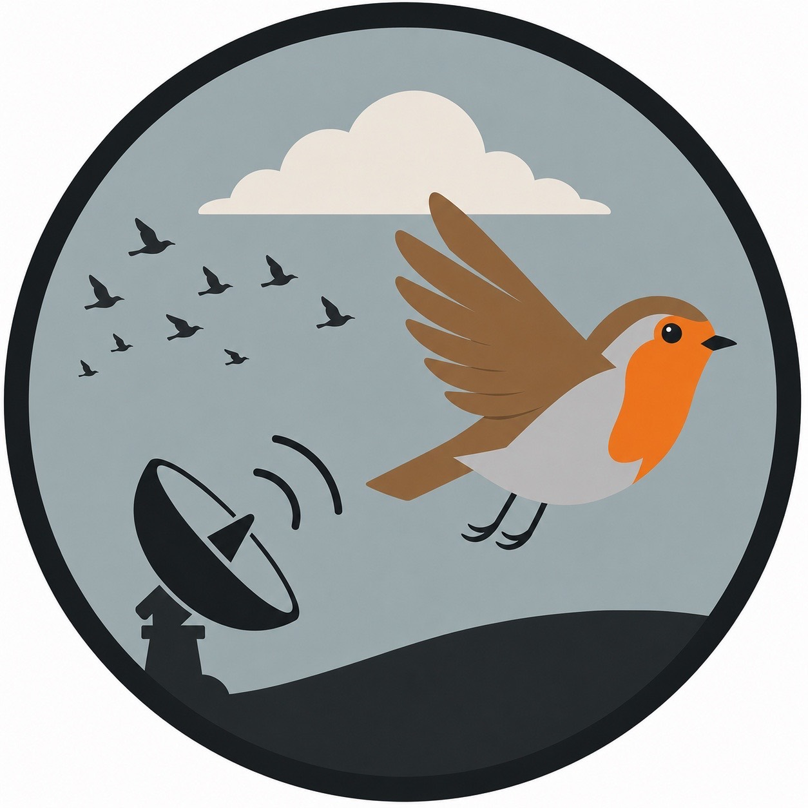
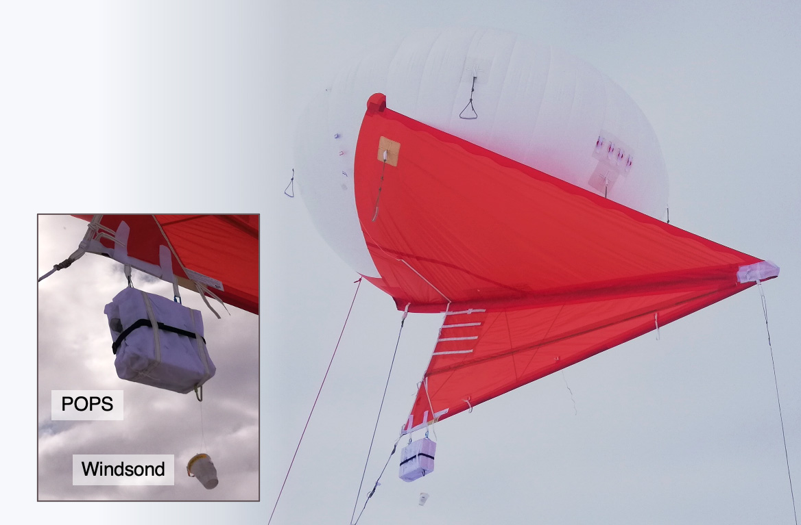
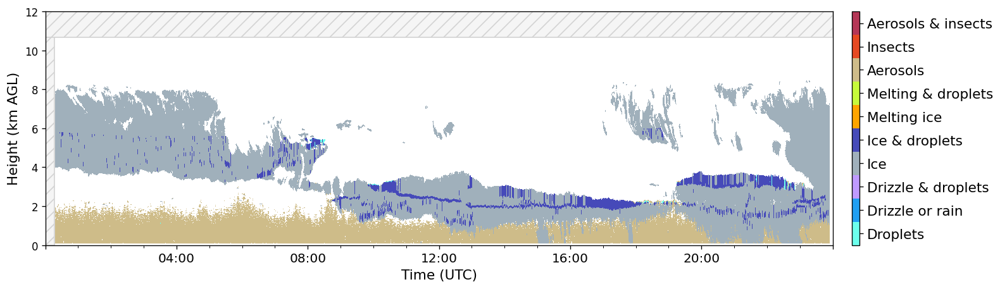

<!-- _class: discuss -->

# NCAS radars

Weather, wildlife and two new observatories

Professor Ryan R. Neely III · NCAS Operations Network · 4 November 2026

<!--
00:00–00:35

The Atmospheric Measurement and Observation Facility, or AMOF, gives researchers access to instruments and to the people who know how to use them. I want to show you what we can see with those instruments and where your work comes in.
-->

---

# How does a radar work?

Send a pulse. Listen for the echo.

The time for the round trip gives us the distance.

<!--
00:35–01:20

Point to the pulse as it travels out, then to the weaker echo coming back. We know the speed of radio waves. A later echo has travelled farther, and the direction of the beam tells us where to look. Repeat the measurement in different directions and we can map the rain.
-->

---

# Doppler measures motion along the beam

A passing siren sounds higher as it approaches and lower as it recedes.

<!--
01:20–02:10

The waves bunch together in front of the car and spread out behind. Radar uses radio waves and compares successive echoes to see how fast particles move towards or away from the instrument. A wind blowing straight across our beam can look still. Remember that when we get to WOEST.
-->

---

# Polarisation gives us clues to shape

We compare echoes from horizontally and vertically polarised radio waves.

A large, flattened raindrop returns a different pair of echoes from a nearly spherical drop.

<!--
02:10–02:55

Both waves travel out along the same beam. The electric field oscillates in two orientations. If a group of raindrops is wider than it is tall, the two echoes can differ. Alongside other measurements, that difference helps us recognise rain, snow, hail and even insects.
-->

---

# Weather radar and cloud radar

**Weather radar** follows rain and storms across a landscape.

**Cloud radar** detects smaller particles inside clouds.

<!--
02:55–03:35

Both systems can see precipitation. The difference is the view each gives us. With a mobile weather radar we can follow a passing shower over an area. The cloud radar can pick out small particles higher up, including in clouds that produce no rain at the ground. The photograph shows the original NXPol at Burn Airfield. Credit: Neely III et al. (2018), Fig. 1, CC BY 4.0.
-->

---

# Weather and Precipitation Observatory

How much of the rain we see aloft reaches the ground?

NXPol-2 scans the sky. A camera measures individual drops and a gauge weighs the rain at its site.

<!--
03:35–04:35

The vision is to bring those measurements together. A local base would let us collect a long record, test methods, train users and keep instruments ready to deploy. The choice of site matters. To compare the observations well, we need to know what part of the storm the radar sampled near the gauge.
-->

---

# Cloud and Boundary-Layer Observatory

What does the air below a cloud tell us about how it grows?

The plan brings cloud radar, lidar and a microwave radiometer together in a mobile laboratory.

<!--
04:35–05:35

The boundary layer is the part of the atmosphere closest to the ground. It supplies heat and moisture to clouds. A radar detects cloud particles, lidar can measure winds, and the radiometer helps estimate atmospheric water. Putting those instruments side by side means we can follow the same cloud at the same time. The mobile observatory is under development.
-->

---

# Our radar went to the Alps

Mount Plose, Italy · summer 2025

How do mountains change where storms develop and rain falls?

<!--
05:35–06:10

The TEAMx campaign took NXPol-2 to Mount Plose. From there it could scan across alpine terrain and record rain over the surrounding area. The archive contains observations from June to September. Finding a site with a useful view, a route in and power is part of planning the measurement.
-->

---

# Why we needed five radars for WOEST

Southwest England · summer 2023

Two NCAS mobile weather radars joined three Met Office radars. Together their different views let us reconstruct the wind inside storms.

<!--
06:10–07:25

WOEST asked why some summer clouds develop into storms while others fade. NCAS and Leeds led the project alongside the Met Office WesCon campaign. The radar teams had to agree where to point the instruments and when. Lidar, balloons and weather drones also sampled the air feeding the clouds. Rob Thompson and colleagues combined the five weather radars to estimate how the wind changed in three dimensions every ten minutes.
-->

---

# Two columns of rising air in one storm

2 August 2023, 13:30 UTC. Colours show echo strength. Arrows show the estimated wind in this vertical slice.

<!--
07:25–09:10

Start with the horizontal axis and read across the storm. Height increases upwards. Ask the room where they see the arrows turn upwards. Two columns of rising air are about seven kilometres apart. The colour is echo strength, rather than wind speed. The arrows are the wind reconstructed by combining the different radar views. Estimates of vertical motion are more uncertain close to the ground. A map of surface rainfall alone could not show us those two columns. Credit: Thompson et al. (2026), Fig. 12a, CC BY 4.0. The panel is cropped from the full figure.
-->

---

# Weather radars can detect insects

BioDAR used eight years of observations from fifteen Met Office radars.

Over that period, estimated airborne arthropod abundance declined at dusk and at night across the areas sampled.

<!--
09:10–10:10

Ask what else can produce an echo on a dry day. Insects and other small animals scatter radio waves too. The study covers 2014 to 2021. The daytime pattern varied across the country. Radar samples animals in flight and the classification has uncertainty. It gives us a record of the living atmosphere over a much wider area than we could sample by hand.
-->

---

# Weather radars also see birds

Historical radar observations show where and when birds were moving.

<!--
10:10–10:45

The data pick up movements at night, when observers on the ground see little. They describe birds aloft in the areas the radars sample. We are exploring what these records could contribute to conservation. They do not resolve individual species.
-->

---

# Clouds help determine what happens to polar ice

Snowfall adds mass. Cloud cover changes how much energy reaches the surface.

<!--
10:45–11:15

A polar cloud can contain ice crystals and liquid droplets at the same time, even below zero degrees. The mix of ice and liquid changes how the cloud interacts with sunlight and infrared radiation. Measuring it matters when we test whether our models get the surface energy budget right. The photograph shows a helikite at Summit Station in Greenland. Credit: Guy et al. (2024), Fig. 2, CC BY 4.0.
-->

---

# Troll, East Antarctica

A staffed research station gives us a year-round base to study clouds and snowfall.

<!--
11:15–12:05

At Troll we can compare a radar record of snow and ice with lidar and microwave observations of the same cloud. Colleagues at the station, the remote instrument teams and the data centre all contribute to the record. Here is a day when the distinction between ice and liquid mattered.
-->

---

# Ice and liquid in the same cloud

Troll, 31 December 2025. Time runs across the plot and height runs upwards.

<!--
12:05–13:25

Follow the blue layer near two kilometres around the middle of the day. Blue marks ice and liquid droplets together. Above it, the classification suggests ice. Each instrument is sensitive to something different, and bringing the observations together helps us infer what the cloud contains. We can then ask whether a model put its liquid water at the same height and for the same length of time.
-->

---

# AURORA is testing off-grid observations

We are testing the GAMB2LE observatory in Iceland, ahead of future work in Greenland.

<!--
13:25–14:25

At Troll we can draw on a staffed station. AURORA asks what it would take to make sustained measurements where there is no mains supply and nobody available to reset an instrument. The Iceland test gives us the chance to learn what happens to the whole system through changing conditions.
-->

---

# What has to work when we leave?

Can we tell what has stopped?

Can we recover remotely?

Can the measurements survive a break in communications?

<!--
14:25–15:20

Winter changes the energy available from solar panels, and cold puts demands on batteries and equipment. Losing the link does not by itself tell us the instrument stopped. We need to think through local recording, what information can reach us, and what happens when the system restarts.
-->

---

# Weather drones sample the air above the site

A temperature and humidity profile gives us another view of the lowest part of the atmosphere.

<!--
15:20–15:55

A drone can climb through a layer that we have been watching remotely and sample its temperature and humidity directly. The aim is to combine those measurements with observations made from the ground. Reliable flights in polar conditions are still a development task.
-->

---

# Will’s wind measurements at sea

A ship rolls and pitches. How can a lidar distinguish the motion of the air from the motion of the deck?

RRS Sir David Attenborough

<!--
15:55–17:00

Will Barker is developing ship-based Doppler lidar measurements with the British Antarctic Survey. We want to measure winds over the ocean. A moving deck changes both the direction the beam points and the apparent motion along it. Knowing the orientation and motion of the instrument is part of making a usable wind measurement.
-->

---

# Meet the team

**Radar and engineering** · Lindsay Rhodes, Dave Dufton and Alex Fearn

**Lidar and polar observations** · Will Barker, Heather Guy and Sarah Barr

**PhD researchers** · Andrew Martin, Imogen Wadlow, Clare Ballantyne and Emily Smeaton

<!--
17:00–17:50

These contributions overlap. Lindsay works on radar operations and partnerships, Dave on radar data and rainfall, and Alex on field systems. Will has been developing lidar observations at sea. Heather and Sarah bring polar cloud and field-observing expertise. Our doctoral researchers work across these questions and make measurements of their own.
-->

---

# Where NCAS Ops comes into the measurement

**Before deployment** · Can we get the equipment, people and power to the site?

**While we observe** · Who can see when something stops, and who can act?

**After the campaign** · Can another team find the observations and use them?

<!--
17:50–19:40

For WOEST, the sites and observation periods had to line up before the five radars could see the same storm. For our two mobile observatories, the home base has to support maintenance, training and field preparation. Finance and contracts can help us work out what has to be ordered first and which agreements have long lead times. Workshop and project colleagues know the practical constraints on building, testing and shipping. The People team helps us staff the work, and IT and communications colleagues support data transfer and access. We can give Ops an observing plan and its constraints early enough to make those decisions together.
-->

---

<!-- _class: discuss -->

# What would you need from us before either observatory goes into the field?

NCAS Operations Network · 4 November 2026

<!--
19:40–20:00

Pause for questions. If the room wants a concrete starting point, the next two slides each support five minutes of discussion. Choose whichever fits the people in the room.
-->

---

<!-- _class: discuss -->

# A radar sees rain over a gauge. Why might the readings differ?

The radar samples a volume of air. The gauge collects rain at one spot on the ground.

What would you check before comparing the two?

<!--
Optional discussion 1 · five minutes

Optional five minutes. Give the room a moment to think, then take two suggestions. Rain takes time to fall. A wind can carry it sideways, and some drops evaporate before reaching the ground. Ask what else the team needs to interpret the comparison: the beam height, gauge location, aligned clocks, the accumulation period and maintenance records. Finish by asking which of these choices we can settle before fieldwork.
-->

---

<!-- _class: discuss -->

# AURORA stops sending data. Has it lost power or lost the link?

What would you want the station to record locally?

What could it send when the connection returns?

<!--
Optional discussion 2 · five minutes

Optional five minutes. This is a design exercise. Give the audience a minute to compare explanations. Losing contact looks the same from here whether the link has failed or the entire station has lost power. If the connection returns, a local record of battery voltage, instrument status and last restart can help distinguish them. Who would see the message, who could restart the system, and when would we ask for a site visit?
-->

---

# Following Antarctic weather through the seasons

A day shows one cloud. A long record lets us ask whether models reproduce the frequency, height and persistence of those clouds in different seasons.

<!--
Backup · untimed

Backup. A radiosonde provides a profile of the air over the station. The value comes from placing each profile alongside the remote-sensing record, across ordinary weather and extremes.
-->

---

# Which radar is which?

| Instrument                       | What it helps us study                                     |
| -------------------------------- | ---------------------------------------------------------- |
| NCAS NXPol-2                     | Rain and storms across a region                            |
| AMOF cloud radar capability      | Small particles and precipitation inside clouds            |
| Troll cloud radar                | Antarctic cloud and snowfall profiles                      |
| Met Office weather radar network | National rainfall, alongside research on insects and birds |

<!--
Backup · untimed

Backup. The AMOF mobile facilities, instruments at Troll and the national radar network serve different purposes. Check the instrument catalogues for the current operating status of individual systems.
-->

---

# Sources and observations

[AMOF weather radar](https://amof.ac.uk/instruments/x-band-mobile-weather-radar/) · [AMOF cloud radar](https://amof.ac.uk/instruments/mobile-cloud-radar/)

[WOEST archive](https://catalogue.ceda.ac.uk/uuid/36756ff1928f4a1684902b470cda774e/) · [Five-radar wind field](https://doi.org/10.5194/egusphere-2026-4631)

[BioDAR paper](https://doi.org/10.1111/gcb.70425) · [UK BirdCast](https://github.com/rrniii/uk-birdcast)

[Troll observations](https://cloudnet.fmi.fi/site/troll) · [GAMB2LE](https://www.gamb2le.co.uk/)

<!--
Backup · untimed

Backup. The README contains image credits, original sources and build instructions.
-->
